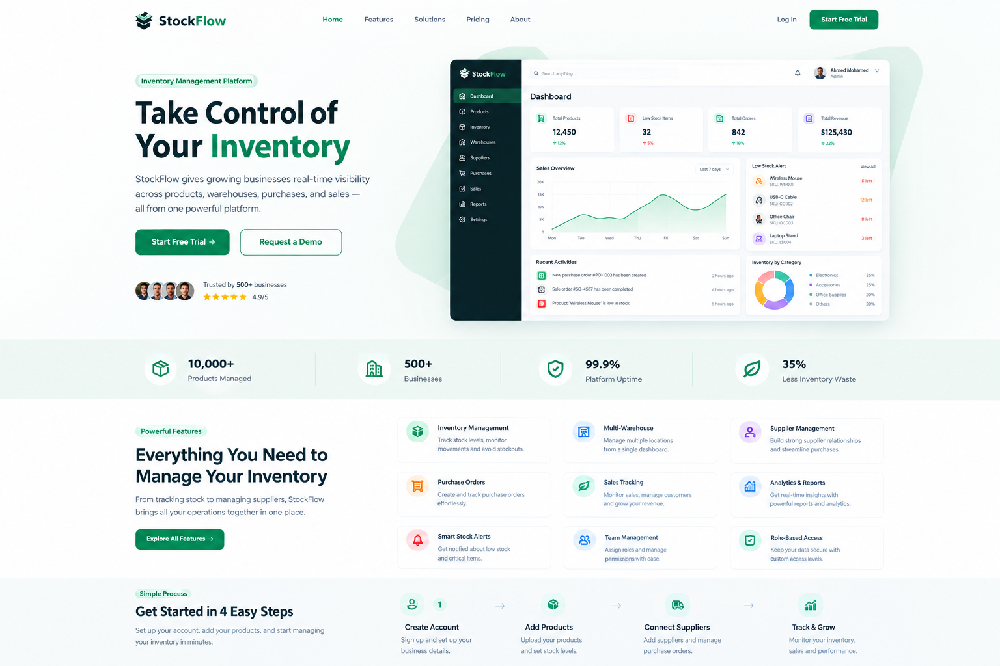
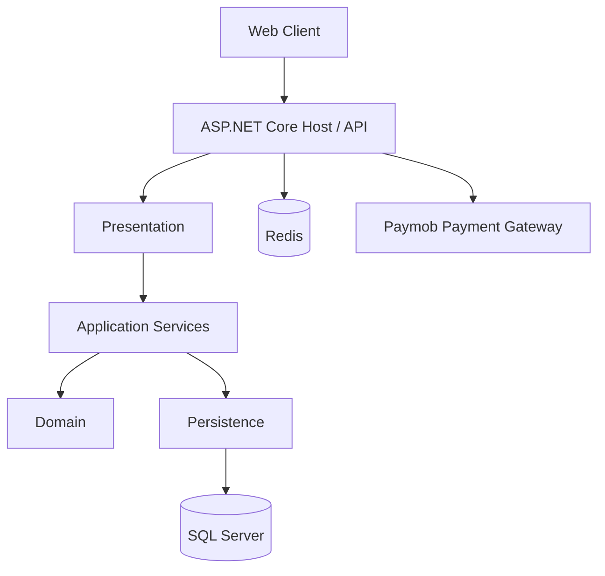

# StockFlow

**StockFlow** is a multi-tenant inventory and business management SaaS application built with ASP.NET Core and SQL Server. It helps businesses manage products, categories, warehouses, inventory, suppliers, customers, purchase orders, sales orders, and team access from one platform.

<p align="center">
  <a href="http://stockflow.runasp.net/index.html">
    
  </a>
</p>

<p align="center">
  <a href="http://stockflow.runasp.net/index.html">Live application</a> ·
  <a href="https://github.com/Omar-adel11/StockFlow">Source code</a>
</p>

> The live application may require registration and sign-in. Available functionality depends on the account role and subscription status.

---

## Table of Contents

- [Overview](#overview)
- [Features](#features)
- [Technology Stack](#technology-stack)
- [Architecture](#architecture)
- [Engineering Highlights](#engineering-highlights)
- [Getting Started](#getting-started)
- [Configuration and Secrets](#configuration-and-secrets)
- [API and Application Usage](#api-and-application-usage)
- [Repository Structure](#repository-structure)
- [Security Notes](#security-notes)
- [Roadmap](#roadmap)
- [Author](#author)

## Overview

StockFlow is designed around the needs of businesses that need a central place to manage inventory and day-to-day operations. The platform supports multiple businesses while separating their data and permissions.

The application includes business-facing workflows as well as platform-level SaaS administration, subscription plans, and payment checkout.

## Features

### Business Operations

- **Dashboard:** overview of business operations.
- **Products and categories:** organize products and their classifications.
- **Inventory:** view and manage stock levels and inventory adjustments.
- **Warehouses:** manage multiple warehouses and transfer products between them.
- **Purchase orders:** manage purchasing workflows.
- **Sales orders:** manage sales workflows.
- **Customers and suppliers:** maintain business contacts.
- **Team management:** invite team members and manage their roles.

### SaaS Capabilities

- Multi-tenant business data separation.
- Role-aware access for platform administrators, business owners, managers, and staff.
- Subscription plans and free-trial support.
- Subscription checkout through Paymob.
- SaaS administration for business owners and plans.

### Platform Capabilities

- JWT-based authentication and authorization.
- Refresh-token lifecycle management.
- Redis-backed caching.
- Centralized application logging with Serilog.
- Responsive web interface.

## Technology Stack

| Area | Technologies |
|---|---|
| Backend | C#, ASP.NET Core Web API (.NET 8) |
| Architecture | Separated Domain, Application, Persistence, and Presentation projects |
| Database | Microsoft SQL Server |
| ORM | Entity Framework Core |
| Caching and token state | Redis |
| Authentication | JWT |
| Payments | Paymob |
| Logging | Serilog |
| Frontend | HTML, CSS, JavaScript |

## Architecture

The backend is organized into separate projects to keep core business concepts, application workflows, persistence concerns, and HTTP presentation responsibilities distinct.



The diagram is a high-level conceptual view of the main components and integrations.

## Engineering Highlights

### Multi-Tenant Data Isolation

StockFlow supports multiple businesses in the same application. Tenant context is associated with the authenticated user, and tenant-aware data access is used to keep business records separated.

### Authentication and Refresh Tokens

The application uses JWT-based authentication and role-aware authorization. Refresh-token state is managed separately from short-lived access tokens, with Redis used as part of the refresh-token lifecycle.

### Caching

Redis is used for application caching. Cache expiration and invalidation are important parts of keeping cached data consistent with changes made through business workflows.

### Subscription and Payment Workflow

The platform includes subscription-plan management and Paymob checkout integration. Payment-provider callbacks are part of the subscription workflow.

### Centralized Logging

Serilog is used to provide structured application logging, helping make application behavior and failures easier to investigate.

## Getting Started

### Prerequisites

- .NET 8 SDK
- Microsoft SQL Server
- Redis (for Redis-backed features)
- Git

### Clone the Repository

```bash
git clone https://github.com/Omar-adel11/StockFlow.git
cd StockFlow
```

### Configure the Application

Locate the ASP.NET Core host project under:

```text
Backend/StockFlow/StockFlow
```

Configure the database connection string and Redis connection string for your local environment. Add any required authentication, email, and payment-provider settings through .NET User Secrets or environment variables.

### Apply Database Migrations

Run the Entity Framework Core migration command from the appropriate startup-project and migrations context for the solution:

```bash
dotnet ef database update
```

If the solution contains multiple projects, specify the relevant project and startup project using the Entity Framework Core CLI options.

### Run the Application

From the ASP.NET Core host project:

```bash
dotnet restore
dotnet run
```

The ASP.NET Core application serves the frontend assets from its `wwwroot` directory.

## Configuration and Secrets

The application depends on environment-specific configuration. Before running locally, configure the values required by your environment, including:

- SQL Server connection string.
- Redis connection string.
- JWT signing configuration.
- Email provider settings, if using email workflows.
- Paymob credentials and webhook configuration, if testing payment workflows.

**Never commit real credentials, connection strings, signing keys, or payment-provider secrets.** Use local development secrets or environment variables.

## API and Application Usage

The live application is available at:

**[Open StockFlow](http://stockflow.runasp.net/index.html)**

After registering or signing in, the available workflows depend on the user's role and the business subscription.

The main API capabilities correspond to the business modules listed in [Features](#features). For endpoint-level documentation, use the API's configured OpenAPI/Swagger endpoint when running the backend, if enabled in the current environment.

## Repository Structure

The repository contains the backend solution and the web client assets. The backend is divided into the following responsibilities:

| Project / Area | Responsibility |
|---|---|
| Domain | Core business entities and domain concepts |
| Application | Application services, DTOs, and use-case logic |
| Persistence | Database access and persistence implementation |
| Presentation | API endpoints and HTTP presentation concerns |
| ASP.NET Core host | Application startup, configuration, middleware, and frontend hosting |
| Frontend assets | HTML, CSS, and JavaScript user interface |

## Security Notes

- Keep secrets outside source control.
- Use role-aware authorization for protected operations.
- Preserve tenant boundaries when adding or modifying data-access workflows.
- Validate external payment callbacks according to the payment provider's security requirements.
- Do not use production credentials in local development or public examples.

## Roadmap

Potential areas for continued improvement:

- Expand automated unit and integration test coverage.
- Document key API request and response examples.
- Add architecture and database diagrams based on the current implementation.
- Document deployment and operational procedures.
- Add continuous integration checks for restore, build, and tests.

## Author

**Omar Adel**

- GitHub: [Omar-adel11](https://github.com/Omar-adel11)

---

If you find an issue or have a suggestion, feel free to open a GitHub issue.
